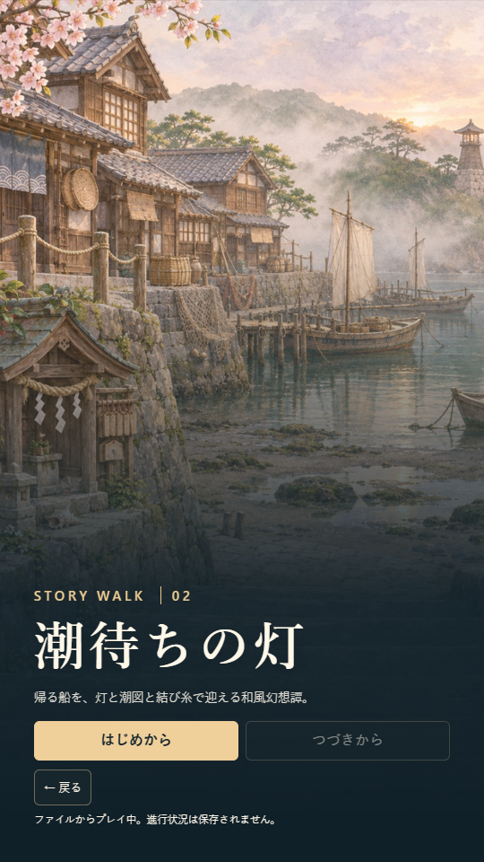
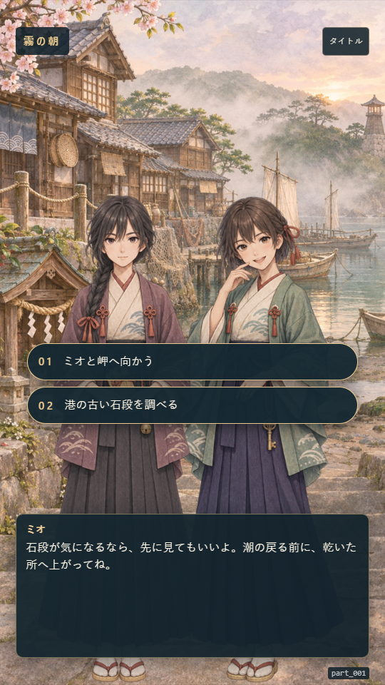
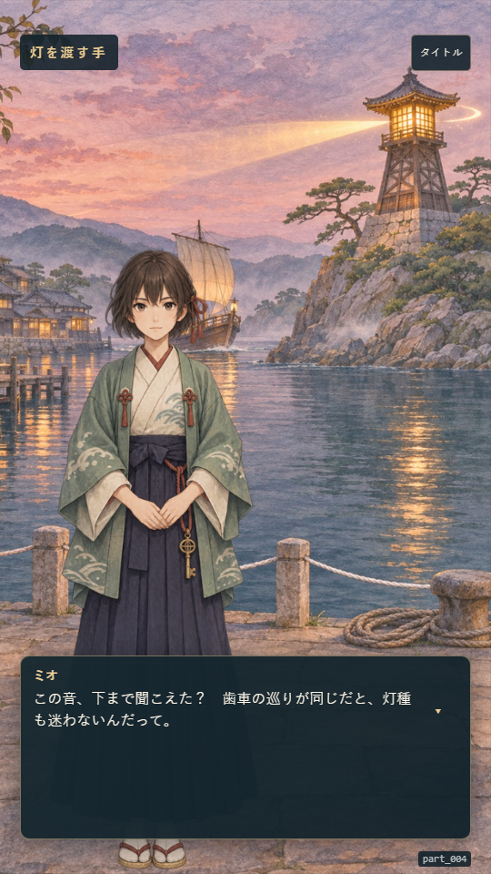

# 潮待ちの灯

**[実際に動く公開版をブラウザで遊ぶ](https://chocomintice.ccsp.mydns.jp/HPStore/web-benri-tools/Tidelight/)**

**分岐のあるストーリーを書き、ブラウザで遊べる形にするための、小さなベース・フレームワークです。**

システムとして真新しいものはありません。むしろ、単純でシンプルです。会話を読み、二択で進む先を選び、結末へたどり着く。「分岐のあるストーリーを書きたい」という要求にシンプルに応える、ベアボーンとして作りました。

<p align="center">
  
  
  
</p>

## 分岐を広げる、AI と書く

選択の先にまた選択があり、物語はどんどん分岐していきます。分岐を重ねるほど、書くべき展開は爆発的に増えます。それぞれの道筋で人物や出来事のつじつまを合わせる、ライター泣かせの構造です。

今は、その執筆を AI に任せることもできます。このリポジトリでは AI が設定を参照しながら書けるよう、ストーリーのベース情報と個々のキャラクター情報を整理しています。世界観・用語・時系列、物語開始時点、人物ごとの性格・生い立ち・口調・行動規範・人間関係、そして各パートの接続を、[執筆資料](docs/story/README.md)からたどれます。

これらは Markdown で管理する設定資料です。AI が執筆する際の共通の参照元にしています。設定資料を更新するときは、実際の台詞や分岐との整合性も確認していく運用です。

## サンプルストーリー「潮待ちの灯」

舞台は、和風ファンタジーの小さな港町「潮待ち」。故郷へ戻った主人公が、灯守見習いのミオ、潮図師見習いのレン、祠の名預かりサヨとともに、帰る船を灯と潮図と結び糸で迎える一日の物語です。

岬で帰り灯の準備を手伝うか、干潮に現れた石段を調べるか。選んだ先で、関わる仕事や交わす約束が変わります。現在は12パート、10の経路、6種類の結末を収録しています。背景と立ち絵は ImageGen で制作しています。

## 遊んでみる

リポジトリをダウンロードし、`DocRoot/index.html` をブラウザで開くと遊べます。スマートフォンの縦持ちを想定した画面で、PC でもプレイできます。

画面のタップ・クリック、または Enter / Space で会話を進め、選択肢のボタンで進む道を選びます。文字が表示されている途中の操作で全文を表示できます。

ファイルを直接開いた場合、進行状況は保存されません。自動保存と「つづきから」を使うには、リポジトリのルートで次を実行し、[ローカルのゲーム画面](http://127.0.0.1:8000/)を開いてください（Node.js が必要です）。

```sh
node tools/serve.mjs
```

## 自分の物語を書くには

会話・背景・立ち絵・選択肢は、パートごとのデータに記述します。HTML・JavaScript と画像で動き、公開時は `DocRoot/` の中身を配置します。

シナリオ追加や公開、検証の手順は [開発・運用ガイド](docs/development.md)、世界観や人物設定は [シナリオ執筆資料](docs/story/README.md)、作業時のルールは [AGENTS.md](AGENTS.md) を参照してください。
